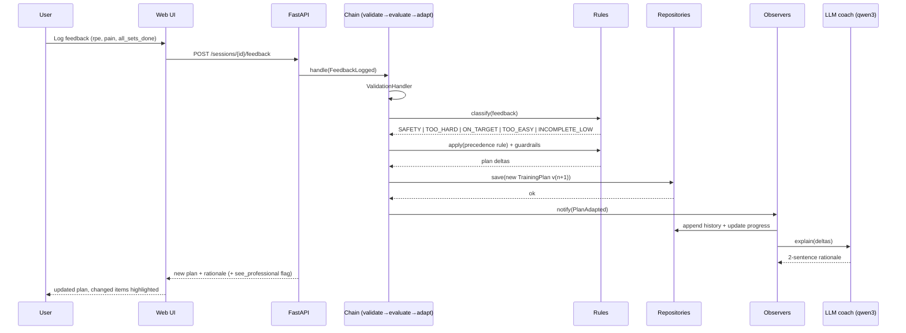
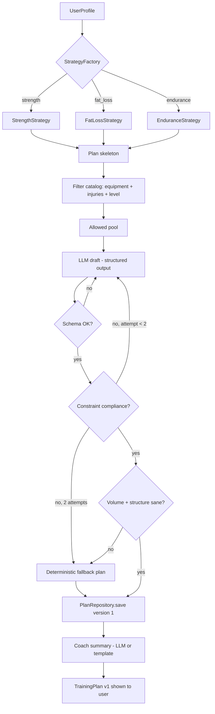

# Adaptive Fitness Agent — Functional Flow

**Owner:** Rahul · **Status:** draft v1 (for team review) · **Date:** 2026-11-15
**Companion document:** `Design_Pattern (1).pdf` (Group 07 project proposal)
**Scope:** what the system *does*, step by step, from onboarding to plan adaptation.
Not in scope here: class structure and pattern internals (→ UML class/sequence diagrams), storage schema details (→ Repository implementation).

---

## 0. Governing design decision

Two different kinds of logic are kept strictly apart. Everything below follows from this rule:

| Concern | Who decides | Why |
|---|---|---|
| **Is this plan safe / does it fit the profile?** | Deterministic rule engine | Predictable, testable, auditable |
| **Does the plan change, and how much?** | Deterministic rule engine | Safety-relevant, must be reproducible in tests |
| **How is the plan phrased and explained?** | LLM (LangChain + Ollama `qwen3`) | Natural language is the only reason to call a model |

**Consequence:** the LLM *drafts* and *explains*; it never has the last word. Every LLM output passes a
validation gate (schema + constraint compliance) before it can reach the user or the database. If the
gate fails after two retries, a deterministic fallback path produces the plan. The app therefore works
with the model switched off.

---

## 1. Actors and components

| Actor / component | Responsibility |
|---|---|
| **User (trainee)** | Enters profile, views plan, logs feedback, asks the coach questions |
| **Web UI** (FastAPI-served) | Forms for onboarding/feedback, plan display, coach chat |
| **Validation handler** | Rejects malformed or unsafe input before it is used |
| **StrategyFactory → PlanningStrategy** | Encodes *what a good plan looks like* for one goal (split, volume, rep ranges) |
| **Exercise catalog** (local data) | Exercise pool with equipment + contraindication tags |
| **LLM coach** (ChatOllama / qwen3) | Drafts the plan from a filtered pool; writes explanations and answers |
| **Adaptation rules** | Turns feedback into concrete plan changes |
| **Repositories** (SQLite) | Persist profiles, plan versions, feedback |

---

## 2. Core data model (logical — field names, not final schema)

```text
UserProfile
  id, age, fitness_level (beginner|intermediate|advanced),
  goal (strength|fat_loss|endurance), days_per_week (1..7),
  equipment[] (bodyweight|dumbbells|barbell|kettlebell|bands|pullup_bar|machines),
  injuries[]  ({region: knee|shoulder|lower_back|wrist|ankle|neck|hip, note?}),
  created_at

Exercise
  id, name, movement_pattern (squat|hinge|push|pull|carry|core|cardio),
  required_equipment[], contraindicated_regions[],
  is_compound (bool), default_rep_range, load_type (kg|bw|rpe|time)

Session
  id, plan_id, week, day_of_week, focus (e.g. "push"), duration_min, exercises[]

PlannedExercise
  exercise_id, sets, reps, load (kg | bodyweight | RPE), rest_s, notes, order

TrainingPlan
  id, user_id, version (1..n), weeks[], sessions[], created_at,
  llm_generated (bool), coach_summary (text), is_active (bool)

FeedbackEntry
  id, session_id, rpe (1..10), pain (bool), pain_region?,
  all_sets_done (bool), completed_sets?, note?, created_at
```

**Immutability rule:** a `TrainingPlan` is never edited in place. Adaptation always creates a new
version (`version + 1`) and marks it active. All previous versions stay readable — that is what makes
the progress view and the audit trail possible.

---

## 3. Flow F1 — Onboarding → `UserProfile`

**Trigger:** first login, or user presses "Redo onboarding".

1. The UI collects six inputs: **age**, **fitness level**, **goal**, **available days/week**,
   **available equipment**, **injuries/limitations**.
2. Client-side checks give instant feedback (required fields, numeric ranges); they are a convenience only.
3. `ValidationHandler` (Chain of Responsibility, step 1) validates authoritatively on the server:

   | Field | Rule | On violation |
   |---|---|---|
   | age | integer 14–90 | reject, re-prompt |
   | age < 18 | flag `minor = true` | conservative volume caps + note in plan |
   | fitness_level | one of the three enum values | reject, re-prompt |
   | goal | one of `strength`, `fat_loss`, `endurance` | reject, re-prompt |
   | days_per_week | integer 1–7 | reject, re-prompt |
   | equipment | subset of the known list; `bodyweight` always implicit | drop unknown values |
   | injuries | region ∈ known list, optional free-text note | unknown region → keep as free text, treat conservatively |

4. `ProfileRepository.save(profile)` persists it and returns the id.
5. The user is forwarded directly to plan generation (F2).

**Output:** a validated `UserProfile`.
**Edge cases:** 7 days/week → still enforced: at least one rest day is scheduled (see guardrails §6.4).
No equipment at all → allowed; the strategy restricts the pool to bodyweight and the plan is marked
`bodyweight_only`. Injury noted for a region that blocks a whole movement pattern → the strategy
substitutes within the pattern or, if nothing is safe, omits the pattern and says so in the summary.
**LLM involvement:** none. This step must be identical on every run.

---

## 4. Flow F2 — Plan generation → `TrainingPlan` v1

**Input:** validated `UserProfile`.

1. **Strategy selection (Factory).** `StrategyFactory.create(profile)` returns one of
   `StrengthStrategy`, `FatLossStrategy`, `EnduranceStrategy`, chosen by `profile.goal`
   (and refined by `fitness_level`). New goals are added by registering a new strategy — no existing
   code changes.

2. **Deterministic skeleton.** The strategy produces the *shape* of the plan:
   - split template mapped onto `days_per_week` (e.g. 3 days → full body ×3; 4 days → upper/lower ×2),
   - target sets per muscle group per week for this goal and level,
   - rep ranges, rest times, session duration budget.

3. **Candidate pool filtering (hard safety filter).** From the exercise catalog, remove every exercise that
   - requires equipment the user does not have, **or**
   - is contraindicated for a reported injury region, **or**
   - exceeds the level (e.g. advancedskill work for a beginner).
   What remains is the **allowed pool**. The LLM will only ever see this pool.

4. **LLM draft (LangChain).** One structured call to `qwen3` via `ChatOllama` with:
   the profile, the skeleton, and the allowed pool. The model returns JSON validated against a Pydantic
   `TrainingPlan` schema (`with_structured_output`), filling in concrete exercises, sets, reps, load.

5. **Validation gate (deterministic, always runs):**
   - *Schema complete* — required fields present, types correct, ids exist.
   - *Constraint compliance* — every exercise ∈ allowed pool (equipment + injury safe). **Hard fail.**
   - *Volume sanity* — sets × reps within the goal/level range; sessions ≤ `days_per_week`;
     ≥ 1 rest day; total weekly sets within min/max.
   - *Structure sanity* — no duplicate exercise inside a session; sensible ordering (compounds first).
   On failure: repair once by re-prompting with the specific violation, then once more; after two failed
   attempts → **step 6**.

6. **Deterministic fallback.** The strategy itself assembles the plan from the allowed pool using fixed
   selection rules (no LLM). Result is flagged `llm_generated = false`. The user still gets a valid plan.

7. **Coach summary (LLM, optional path).** A second, text-only call asks the model to explain *why* this
   plan fits the profile. Stored as `coach_summary`. If the model is unavailable, a templated summary
   is used. This text is presentation only — it never feeds back into decisions.

8. **Persist.** `PlanRepository.save(plan)` with `version = 1`, `is_active = true`.
   `Observer` → history entry created, progress baseline initialised.

**Output:** `TrainingPlan` v1 displayed in the UI (week × session × exercises), plus the coach summary.

---

## 5. Flow F3 — Feedback after a session

**Trigger:** user finishes (or skips) a session and presses "Log feedback", or a nudge on the next visit.

1. The UI asks exactly three questions, matching the proposal:
   - **How hard was it?** — RPE 1–10 (slider).
   - **Did anything hurt?** — yes/no; if yes, which region (same enum as injuries).
   - **Did you complete all sets?** — yes/no; if no, how many sets were done.
   Optional free-text note.
2. `ValidationHandler` checks: `rpe ∈ 1..10`, `pain ∈ {true,false}`, `all_sets_done ∈ {true,false}`,
   `completed_sets ≤ planned_sets`.
3. `FeedbackRepository.save(entry)`, linked to the `session_id`.
4. **Observer fires** → progress tracking updates streaks and the load-per-exercise history.
5. If the model is reachable, the coach writes a short reply acknowledging the entry (text only).

**Output:** a `FeedbackEntry`, and control passes straight to F4.

> **Note:** the decision *what to change* is made in F4 by rules, never by the LLM. The LLM may only
> describe the change afterwards.

---

## 6. Flow F4 — Adaptation → `TrainingPlan` v(n+1)

### 6.1 Chain of Responsibility

`FeedbackLogged` → `ValidationHandler` → `EvaluationHandler` (classify the feedback)
→ `AdaptationHandler` (apply the rules below) → `PersistenceHandler` (new version)
→ observers: `HistoryObserver`, `ProgressObserver`, `CoachObserver`.

### 6.2 Classification

| Signal | Classification |
|---|---|
| `pain = true` | **SAFETY** |
| `rpe ≥ 9`, or `rpe ≥ 8` twice in a row | **TOO_HARD** (severe) |
| `rpe = 8` | **TOO_HARD** |
| `rpe 5–7`, `all_sets_done = true` | **ON_TARGET** |
| `rpe ≤ 4`, `all_sets_done = true` | **TOO_EASY** |
| `all_sets_done = false` and `rpe ≥ 7` | **TOO_HARD** |
| `all_sets_done = false` and `rpe ≤ 6` | **INCOMPLETE_LOW** (likely time/motivation, not load) |

### 6.3 Rule table (deterministic, applied to the exercises of the logged session)

| Precedence | Condition | Action |
|---|---|---|
| **1** | `pain = true` | Swap the offending exercise for a safe alternative (same movement pattern, equipment-available, not contraindicated). Reduce load for that pattern to 60–70 % of previous for the first week. **No load increase anywhere this cycle.** Set `see_professional = true` → coach message advises seeing a professional if pain persists or is sharp/joint pain. |
| **2** | TOO_HARD severe | Deload the affected sessions: −20 % total volume (remove sets, floor 2 sets/exercise) **or** −10 % load, keep rest intervals. |
| **3** | TOO_HARD | −1 set on the hardest exercise of the session **or** −10 % load. Do not touch the rest of the plan. |
| **4** | ON_TARGET | Progress inside the rep range: +1 rep per set; once the top of the range is reached across all sets, +2.5–5 % load. |
| **5** | TOO_EASY | +5 % load (isolation/upper body: +2.5 %). If already at the weekly volume maximum, +1 set instead. |
| **6** | INCOMPLETE_LOW | Keep the plan unchanged. Ask one follow-up question (time, motivation, or session length) and offer a shorter session variant. |

Only **one** branch is taken per exercise per cycle, and branch 1 always wins.

### 6.4 Global guardrails (checked after the rules, before saving)

- Load may rise by at most **+10 % per exercise per week**; volume by at most **+1 set per week**.
- No increase unless the previous session for that exercise was **completed** (`all_sets_done = true`).
- An exercise is never both increased and decreased in the same cycle.
- Sessions per week ≤ `days_per_week`; **at least one rest day** per week.
- Total weekly sets stay within the strategy's min/max for the goal and level.
- Minor flag → volume caps from §3 apply.
- After a pain event, the affected pattern is **held** (no increase) for one week.

### 6.5 Output

1. New `TrainingPlan` with `version = n+1`, `is_active = true`; the old version is kept unchanged.
2. `HistoryObserver` appends the version; `ProgressObserver` updates the trend.
3. `CoachObserver` asks the LLM for a two-sentence explanation: *what changed and why*, in the user's
   language. On model failure → templated sentence derived from the rule that fired.
4. The UI shows: updated plan (with the changed items highlighted), the coach's explanation, and — if
   pain was reported — the recommendation to see a professional.

---

## 7. End-to-end overview

```text
  ┌──────────┐
  │  START   │
  └────┬─────┘
       ▼
  F1 ONBOARDING ── age, level, goal, days, equipment, injuries
       │  ValidationHandler
       ▼
   UserProfile ──────────────────────────────────┐
       ▼                                         │
  F2 PLAN GENERATION                             │
   StrategyFactory → Strategy → skeleton         │  (rules + catalog)
   catalog filter → allowed pool                 │
   LLM draft (qwen3) ──► validation gate ──fail──┤
       │ pass                                    ▼
       │                                  deterministic fallback
       ▼                                         │
   TrainingPlan v1 ◄─────────────────────────────┘
       │  + coach summary
       ▼
   ┌─► user trains ─► F3 FEEDBACK (RPE 1–10, pain?, all sets done?)
   │                        │
   │                        ▼
   │                  F4 ADAPTATION
   │                   classify → rule table → guardrails
   │                        │
   │                        ▼
   └─────────────── TrainingPlan v(n+1) + coach explanation
                            │
                            ▼
                    history / progress (Observer)
```

---

## 8. Sequence — feedback to adapted plan (Mermaid)



---

## 9. Flowchart — plan generation with the validation gate (Mermaid)



---

## 10. API surface (first sketch)

| Method | Endpoint | Purpose |
|---|---|---|
| `POST` | `/profiles` | F1 onboarding → `UserProfile` |
| `GET` | `/profiles/{id}` | read profile |
| `POST` | `/profiles/{id}/plan` | F2 generate plan v1 |
| `GET` | `/profiles/{id}/plan` | active plan |
| `GET` | `/profiles/{id}/plan/versions` | plan history |
| `POST` | `/sessions/{id}/feedback` | F3 log feedback, triggers F4 |
| `GET` | `/profiles/{id}/progress` | aggregated progress view |
| `POST` | `/profiles/{id}/chat` | coach Q&A (LLM only, no side effects) |

---

## 11. Pattern mapping (for the report)

| Pattern | Where it appears in this flow |
|---|---|
| **Strategy** | §4.1 — one planning strategy per goal; new goal = new strategy class |
| **Factory** | §4.1 — `StrategyFactory.create(profile)` picks the strategy, callers stay ignorant of the concrete class |
| **Chain of Responsibility** | §3.3 (validation) and §6.1 (validate → evaluate → adapt → persist); each step small and independently testable |
| **Observer** | §5.4 and §6.5 — history, progress tracking and the coach explanation react to `FeedbackLogged` / `PlanAdapted` without the rules knowing about them |
| **Repository** | §3.4, §4.8, §6.5 — SQLite behind an interface; in-memory implementation for tests |

---

## 12. Test hooks for our two custom metrics

**Constraint compliance** (F2, §4.5): for N generated profiles, assert that every exercise in the plan
is in the allowed pool — no unavailable equipment, no contraindicated movement for a reported injury.
Target: 100 % after the gate (the gate is what makes this number meaningful).

**Adaptation correctness** (F4, §6.3): fixed scenarios, expected outcome asserted:

| Scenario | Expected |
|---|---|
| RPE 3, all sets done, no pain | load +5 % (or +1 set at volume cap) |
| RPE 6, all sets done, no pain | +1 rep per set, load unchanged |
| RPE 8, no pain | −1 set or −10 % load |
| RPE 10 twice, no pain | deload, −20 % volume |
| Knee pain reported | offending exercise swapped, that pattern held, `see_professional = true` |
| RPE 4, sets incomplete | plan unchanged, follow-up question about time/motivation |
| Any rule firing | new version created, old versions untouched, ≤ +10 % weekly load |

---

## 13. Assumptions and open questions (please confirm)

1. **LLM drafts the plan; rules decide adaptations** — matches the proposal. Confirm that the LLM is
   *not* used to decide load changes anywhere.
2. **RPE 1–10 is the only difficulty input** (proposal also mentions recovery and motivation).
   Suggestion: keep recovery/motivation as an optional second screen so the flow stays short — or
   promote them to required inputs if we want them in the rule table.
3. **Injuries are captured as regions from a fixed list + free text**, rather than free text only —
   this is what makes constraint compliance checkable automatically.
4. **Plan length:** 4 weeks by default (macrocycle) with weekly adaptation? Or a single repeating week?
5. **Pain → "see a professional"** is a recommendation and a flag; the app does not diagnose anything.
   Wording to be signed off before it ships.
6. **Exercise catalog** is our own local data (not model-generated), so the safety filter is testable
   without a model. Confirm ownership of this file.
