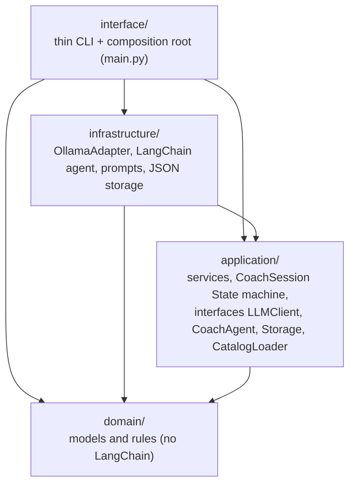

# Architecture

The application is split into four layers. Each layer is a subpackage of `fitness_agent/`.



An arrow means "may import". There are no arrows pointing outward: `domain` imports nothing from the other
layers, and `application` never imports `infrastructure` or `interface`.

## Layers

| Layer | Contains | May import |
|---|---|---|
| `domain/` | Pure Python models and rules: `UserProfile`, `Exercise`, `Feedback`, the `TrainingPlan` Composite, planning Strategies + `StrategyFactory`, `TrainingPlanBuilder`, the allowed-pool filter, the adaptation filters, Commands + `PlanMemento` | standard library, `pydantic` |
| `application/` | Application services used by the states (incl. the LLM retry loop), the `CoachSession` State machine and its states, and the **interfaces** `LLMClient`, `CoachAgent`, `Storage`, `CatalogLoader` | `domain` |
| `infrastructure/` | The **implementations** of those interfaces: `OllamaAdapter` (`LLMClient`), the LangChain agent (`CoachAgent`), `JsonStorage` (`Storage`), `JsonCatalogLoader` (`CatalogLoader`), plus the prompt templates and `ollama_model.py` (the shared model settings) | `application`, `domain`, LangChain, Ollama |
| `interface/` | Two thin views on the same `CoachSession`: the CLI (`cli.py`) and the web chat UI (`web.py`); `main.py`, the composition root | all layers |

`pydantic` is allowed in the domain because it only describes and validates data; it does no I/O and
does not tie the domain to an LLM.

## Dependency rule

**Dependencies point inward only.** This is the Dependency Inversion Principle from SOLID: the
application layer (high-level policy) does not depend on Ollama, LangChain or JSON files (low-level
details). Both depend on an abstraction that the application layer owns:

```text
application.LLMClient (abstract)  ◄── implements ──  infrastructure.OllamaAdapter
        ▲
        └── used by the application services and the states
```

Because the interfaces live in `application/`, the arrow from `infrastructure` to `application` points
inward, even though the call at runtime goes from the application to Ollama.

**How interfaces are defined:** as abstract base classes (`abc.ABC` with `@abstractmethod`). We chose ABCs
over `typing.Protocol` because the "implements" relation is explicit in the code, appears as
inheritance in the class diagram generated by pyreverse, and a class that forgets a method fails as soon
as it is instantiated.

## Composition root: who composes the layers?

`fitness_agent/interface/main.py` is the **only** place that creates concrete classes. It builds
`OllamaAdapter`, the LangChain agent, `JsonStorage` and `JsonCatalogLoader`, passes them into the
application services and the `CoachSession` through their constructors, and starts the CLI. No other
module picks an implementation, so tests can pass a `FakeLLMClient` or an in-memory storage instead.

## The other implementation issues of the Layers slide

- **Skip layers?** Only downward: infrastructure and interface also use the domain models directly
  (e.g. `JsonStorage` saves a `TrainingPlan`), because the models are plain data. An upward import is
  never allowed, and the layer contract checks it.
- **Stateless or stateful?** The domain rules (Strategies, filters, Builder) keep no state between calls.
  The state lives in the data (`TrainingPlan`, `UserProfile`), in `Storage` (the JSON files) and in two
  application objects: `CoachSession` (the current phase of the conversation) and `AdaptationService`
  (the undo history, kept in memory for the running session).
- **Layers are black boxes:** a layer is used only through its public classes and interfaces. The
  application knows `LLMClient`, not `ChatOllama`; the CLI and the web UI know only
  `CoachSession.handle()`.

## How the rule is enforced

The rule is checked automatically by [import-linter](https://github.com/seddonym/import-linter); the
contracts are in `pyproject.toml`:

1. **Layers contract:** `interface > infrastructure > application > domain`. A lower layer may not
   import a higher one.
2. **Forbidden contract:** `domain` and `application` may not import `langchain`, `langchain_core`,
   `langchain_ollama` or `ollama`.

```bash
lint-imports                         # prints KEPT / BROKEN per contract
pytest tests/test_architecture.py    # the same check as part of the test suite
```

A violation fails the test suite, so the layers cannot erode unnoticed. The number of broken contracts
(target: 0) is our coupling metric, together with the import graph from `pydeps`.

## Where to put new code

| New … | Goes into | Why |
|---|---|---|
| goal (e.g. mobility) | new Strategy class in `domain/` + register it in `StrategyFactory` | business rule |
| adaptation rule | new filter in `domain/` | business rule |
| LLM provider (e.g. Groq) | new class in `infrastructure/` implementing `LLMClient`; switch it in `main.py` | external detail |
| storage format | new class in `infrastructure/` implementing `Storage` | external detail |
| menu option or question | a state in `application/states.py`; the CLI only passes input to `CoachSession` | conversation flow |
