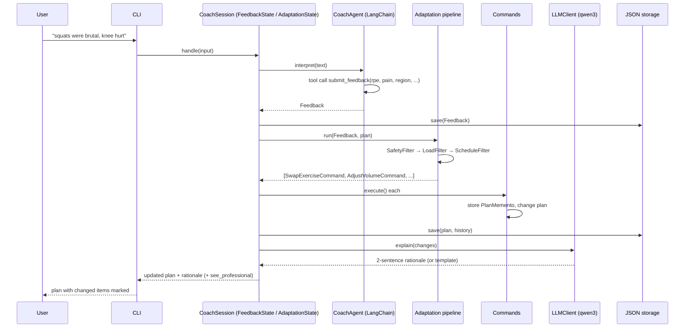
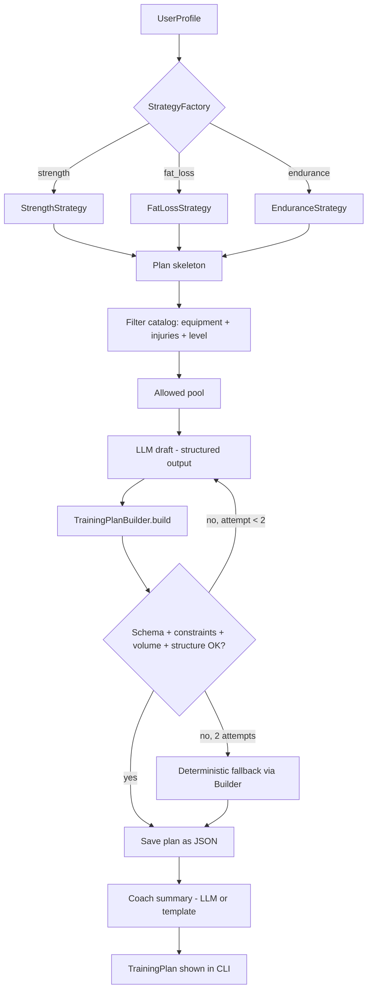

# Adaptive Fitness Agent — Functional Flow

**Owner:** Rahul · **Status:** draft v2 (for team review) · **Date:** 2026-11-16
**Companion document:** Group 07 project proposal (`Design_Pattern (1).pdf`)
**Scope:** what the system *does*, step by step, from onboarding to plan adaptation.
Not in scope here: class structure and pattern internals (→ UML class/sequence diagrams and PATTERNS.md).

### Changes in v2 (aligned with the project plan)

- Interface: thin **CLI** instead of a FastAPI web UI; storage: **JSON files** instead of SQLite.
- Adaptation is a **Pipes & Filters** pipeline (`SafetyFilter → LoadFilter → ScheduleFilter`) instead of Chain of Responsibility.
- Plan changes are **Commands** that store a **Memento** of the plan; this gives the version history and **undo** (replaces the Observer and the "new version" mechanism).
- The plan is a **Composite** (`TrainingPlan → Week → Session → PlannedExercise`), assembled by a **Builder** that runs the validation gate.
- The app flow is a **State** machine (`OnboardingState → PlanReviewState → FeedbackState → AdaptationState`).
- Feedback has a **fourth question: missed sessions** (input for `ScheduleFilter`); free-text feedback goes through the **LangChain agent**.
- "Factory" is named **Simple Factory**; metrics match the plan (validity rate, adaptation safety rate).

---

## 0. Governing design decision

Two different kinds of logic are kept strictly apart. Everything below follows from this rule:

| Concern | Who decides | Why |
|---|---|---|
| **Is this plan safe / does it fit the profile?** | Deterministic rules (Strategy + Builder) | Predictable, testable, auditable |
| **Does the plan change, and how much?** | Deterministic rules (adaptation pipeline) | Safety-relevant, must be reproducible in tests |
| **Understanding the user's words; phrasing and explaining the plan** | LLM (LangChain + Ollama `qwen3`) | Natural language is the only reason to call a model |

**Consequence:** the LLM *understands*, *drafts* and *explains*; it never has the last word. Every LLM
output passes a validation gate (schema + constraint compliance) before it can reach the user or be
saved. If the gate fails after two retries, a deterministic fallback produces the result. The app
therefore works with the model switched off.

---

## 1. Actors and components

| Actor / component | Layer | Responsibility |
|---|---|---|
| **User (trainee)** | – | Enters profile, views plan, gives feedback, can undo the last change |
| **CLI** | interface | Shows the current state and reads input; no business logic |
| **CoachSession + states** | application | Controls the phases: onboarding, plan review, feedback, adaptation (State pattern) |
| **CoachAgent** (LangChain agent) | infrastructure (interface in application) | Turns free-text feedback into a structured `Feedback` via tools |
| **LLMClient / OllamaAdapter** | infrastructure (interface in application) | Wraps the model: `extract_profile()`, `generate_plan()` (Adapter) |
| **StrategyFactory → PlanningStrategy** | domain | Encodes *what a good plan looks like* for one goal (split, volume, rep ranges, progression rule) |
| **TrainingPlanBuilder** | domain | Turns the LLM draft into a `TrainingPlan` Composite and runs the validation gate |
| **Exercise catalog** (local JSON data) | domain data | Exercise pool with equipment and contraindication tags |
| **Adaptation pipeline** | domain | `SafetyFilter → LoadFilter → ScheduleFilter`, emits Commands |
| **Commands + Mementos** | domain | Apply plan changes; snapshot before each change; undo |
| **JSON storage** | infrastructure | Persists profile, plan, feedback and change history |

---

## 2. Core data model (logical — field names, not final schema)

```text
UserProfile
  age, fitness_level (beginner|intermediate|advanced),
  goal (strength|fat_loss|endurance), days_per_week (1..7),
  equipment[] (bodyweight|dumbbells|barbell|kettlebell|bands|pullup_bar|machines),
  injuries[]  ({region: knee|shoulder|lower_back|wrist|ankle|neck|hip, note?}),
  minor (bool, derived from age)

Exercise (catalog entry)
  id, name, movement_pattern (squat|hinge|push|pull|carry|core|cardio),
  required_equipment[], contraindicated_regions[],
  is_compound (bool), default_rep_range, load_type (kg|bw|rpe|time), level

TrainingPlan (Composite root)
  weeks[], coach_summary (text), llm_generated (bool)
  └─ Week (Composite)          number, sessions[]
     └─ Session (Composite)    day_of_week, focus (e.g. "push"), exercises[]
        └─ PlannedExercise (Leaf)  exercise_id, sets, reps, load (kg | bodyweight | RPE), rest_s, notes

  Every level implements: total_volume(), duration(), scale_intensity(factor)

Feedback
  session_ref, rpe (1..10), pain (bool), pain_region?,
  all_sets_done (bool), completed_sets?, missed_sessions (0..n), note?

PlanMemento
  snapshot of the TrainingPlan before a change, plus the reason (which rule fired)
```

**Change rule:** a `TrainingPlan` is only changed by a **Command**. Each Command stores a `PlanMemento`
in `execute()` before changing anything and restores it in `undo()`. The stack of executed Commands is
the plan's version history; "undo last change" pops it.

---

## 3. Flow F1 — Onboarding → `UserProfile`

**Trigger:** first start (no saved profile), or the user chooses "Redo onboarding".
**State:** `OnboardingState`.

1. The CLI asks for six inputs: **age**, **fitness level**, **goal**, **available days/week**,
   **available equipment**, **injuries/limitations**.
2. Answers can be typed freely (e.g. "two dumbbells and a pull-up bar"). `LLMClient.extract_profile()`
   turns the text into the profile fields. This is the only LLM step here, and it only *reads* language.
3. Validation runs deterministically on the result (Pydantic model + rules below), no matter whether the
   values came from the LLM or were typed directly:

   | Field | Rule | On violation |
   |---|---|---|
   | age | integer 14–90 | re-ask |
   | age < 18 | set `minor = true` | conservative volume caps + note in plan |
   | fitness_level | one of the three enum values | re-ask |
   | goal | one of `strength`, `fat_loss`, `endurance` | re-ask |
   | days_per_week | integer 1–7 | re-ask |
   | equipment | subset of the known list; `bodyweight` always implicit | drop unknown values |
   | injuries | region ∈ known list, optional free-text note | unknown region → keep as free text, treat conservatively |

   If extraction fails twice, the CLI falls back to asking each field as a fixed-choice question.
4. The profile is saved as JSON.
5. `OnboardingState` returns the next state → plan generation (F2).

**Output:** a validated `UserProfile`.
**Edge cases:** 7 days/week → still at least one rest day is scheduled (see guardrails §6.4).
No equipment at all → allowed; the strategy restricts the pool to bodyweight exercises.
Injury that blocks a whole movement pattern → the strategy substitutes within the pattern or, if nothing
is safe, omits the pattern and says so in the summary.

---

## 4. Flow F2 — Plan generation → `TrainingPlan`

**Input:** validated `UserProfile`. **State:** `PlanReviewState` shows the result.

1. **Strategy selection (Simple Factory).** `StrategyFactory.create(profile)` returns one of
   `StrengthStrategy`, `FatLossStrategy`, `EnduranceStrategy`, chosen by `profile.goal`.
   New goals are added by registering a new strategy class; the callers do not change.

2. **Deterministic skeleton.** The strategy produces the *shape* of the plan:
   - split template mapped onto `days_per_week` (e.g. 3 days → full body ×3; 4 days → upper/lower ×2),
   - target sets per muscle group per week for this goal and level,
   - rep ranges, rest times, session duration budget,
   - the progression rule used later in adaptation.

3. **Candidate pool filtering (hard safety filter).** From the exercise catalog, remove every exercise that
   - requires equipment the user does not have, **or**
   - is contraindicated for a reported injury region, **or**
   - is above the user's level (e.g. advanced skill work for a beginner).
   What remains is the **allowed pool**. The LLM only ever sees this pool.

4. **LLM draft.** One structured call via `LLMClient.generate_plan()` (OllamaAdapter → `qwen3`,
   `with_structured_output`, temperature 0) with the profile, the skeleton and the allowed pool.
   The model returns a Pydantic `PlanDraft` for **week 1** with concrete exercises, sets, reps and load;
   the Strategy derives weeks 2–4 from it with its progression rule (see §13.4).

5. **Validation gate (Builder, always runs).** `TrainingPlanBuilder` turns the draft into the
   `TrainingPlan` Composite; `build()` checks:
   - *Schema complete* — required fields present, types correct, exercise ids exist in the catalog.
   - *Constraint compliance* — every exercise ∈ allowed pool (equipment + injury safe). **Hard fail.**
   - *Volume sanity* — sets × reps within the strategy's range; sessions ≤ `days_per_week`;
     ≥ 1 rest day; total weekly sets within the strategy's min/max.
   - *Structure sanity* — no duplicate exercise inside a session; compounds first.
   On failure: re-prompt with the specific violation, at most twice; then → **step 6**.

6. **Deterministic fallback.** The strategy assembles the plan from the allowed pool with fixed selection
   rules (no LLM), through the same Builder. Result is flagged `llm_generated = false`.

7. **Coach summary (LLM, optional).** A second, text-only call explains *why* this plan fits the profile.
   If the model is unavailable, a templated summary is used. Presentation only — it never feeds back
   into decisions.

8. **Save** the plan as JSON. The change history starts empty.

**Output:** the `TrainingPlan` shown in the CLI (week × session × exercises), plus the coach summary.

---

## 5. Flow F3 — Feedback after a session

**Trigger:** the user finishes (or skips) a session and chooses "Give feedback".
**State:** `FeedbackState`.

1. The user can describe the session in free text (e.g. "squats were brutal and my knee hurt, skipped
   Thursday"). The **LangChain agent** reads it and calls the `submit_feedback` tool with structured
   arguments. Its other tools are `get_profile`, `get_current_plan` and `undo_last_change`; no tool
   changes the plan directly.
2. If the agent fails (no tool call, invalid arguments, model unavailable), `FeedbackState` falls back to
   four fixed questions that produce the same `Feedback`:
   - **How hard was it?** — RPE 1–10.
   - **Did anything hurt?** — yes/no; if yes, which region (same list as injuries).
   - **Did you complete all sets?** — yes/no; if no, how many sets were done.
   - **Did you miss any planned session?** — number of missed sessions.
3. Validation: `rpe ∈ 1..10`, `completed_sets ≤ planned_sets`, `missed_sessions ≥ 0`, region in the known list.
4. The feedback is saved as JSON, linked to the session.
5. The state machine moves to `AdaptationState` (F4).

**Output:** a validated `Feedback`.

> **Note:** the decision *what to change* is made in F4 by rules, never by the LLM. The LLM may only
> describe the change afterwards.

---

## 6. Flow F4 — Adaptation (Pipes & Filters + Commands)

### 6.1 Pipeline

`Feedback` → `SafetyFilter` → `LoadFilter` → `ScheduleFilter` → list of Commands → execute.

All filters share one interface: they receive the `Feedback`, the current plan and the Commands emitted
so far, and pass them on. Each filter is small and independently testable; a new rule is a new filter.
**Error handling:** if a filter fails, the pipeline stops, no Command is executed, the plan stays
unchanged and the user is told that the plan could not be adapted.

| Filter | Handles | Emits |
|---|---|---|
| `SafetyFilter` | pain (precedence 1) | `SwapExerciseCommand`, `AdjustVolumeCommand` (reduce); sets a "no increase" flag |
| `LoadFilter` | difficulty / completion (precedence 2–6), load guardrails | `AdjustVolumeCommand` |
| `ScheduleFilter` | missed sessions, rest-day guardrail | `RescheduleCommand` |

### 6.2 Classification (inside `LoadFilter`)

| Signal | Classification |
|---|---|
| `pain = true` | **SAFETY** (already handled by `SafetyFilter`) |
| `rpe ≥ 9`, or `rpe ≥ 8` twice in a row | **TOO_HARD** (severe) |
| `rpe = 8` | **TOO_HARD** |
| `rpe 5–7`, `all_sets_done = true` | **ON_TARGET** |
| `rpe ≤ 4`, `all_sets_done = true` | **TOO_EASY** |
| `all_sets_done = false` and `rpe ≥ 7` | **TOO_HARD** |
| `all_sets_done = false` and `rpe ≤ 6` | **INCOMPLETE_LOW** (likely time/motivation, not load) |

### 6.3 Rule table (deterministic, applied to the exercises of the logged session)

| Precedence | Condition | Action |
|---|---|---|
| **1** | `pain = true` | Swap the offending exercise for a safe alternative (same movement pattern, equipment available, not contraindicated). Reduce load for that pattern to 60–70 % of previous for the first week. **No load increase anywhere this cycle.** Set `see_professional = true` → the coach advises seeing a professional if pain persists or is sharp/joint pain. |
| **2** | TOO_HARD severe | Deload the affected session: −20 % total volume (remove sets, floor 2 sets/exercise) **or** −10 % load, keep rest intervals. |
| **3** | TOO_HARD | −1 set on the hardest exercise of the session **or** −10 % load. Do not touch the rest of the plan. |
| **4** | ON_TARGET | Progress inside the rep range: +1 rep per set; once the top of the range is reached across all sets, +2.5–5 % load. |
| **5** | TOO_EASY | +5 % load (isolation/upper body: +2.5 %). If already at the weekly volume maximum, +1 set instead. |
| **6** | INCOMPLETE_LOW | Keep the plan unchanged. Ask one follow-up question (time, motivation or session length) and offer a shorter session variant. |
| **–** | `missed_sessions > 0` (`ScheduleFilter`) | Move the missed session to the next free day of the week if one exists without breaking the rest-day rule; otherwise drop it and do not increase load for that week. |

Only **one** load branch (1–6) is taken per exercise per cycle, and branch 1 always wins.

### 6.4 Global guardrails (checked by the filters against the Strategy's limits)

- Load may rise by at most **+10 % per exercise per week**; volume by at most **+1 set per week**.
- No increase unless the previous session for that exercise was **completed** (`all_sets_done = true`).
- An exercise is never both increased and decreased in the same cycle.
- Sessions per week ≤ `days_per_week`; **at least one rest day** per week.
- Total weekly sets stay within the strategy's min/max for the goal and level.
- Minor flag → volume caps from §3 apply.
- After a pain event, the affected pattern is **held** (no increase) for one week.

### 6.5 Output

1. Each Command is executed; before changing the plan it stores a `PlanMemento` (snapshot + rule that fired).
2. The updated plan and the change history are saved as JSON.
3. The LLM writes a two-sentence explanation of *what changed and why*. On model failure → a templated
   sentence derived from the rule that fired.
4. The CLI shows the updated plan (changed items marked), the explanation, and — if pain was reported —
   the recommendation to see a professional.
5. **Undo:** the user can choose "Undo last change" (or ask the agent, which calls `undo_last_change`);
   the last Command restores its Memento.

---

## 7. End-to-end overview

```text
  ┌──────────┐
  │  START   │
  └────┬─────┘
       ▼
  F1 ONBOARDING (OnboardingState) ── age, level, goal, days, equipment, injuries
       │  extract_profile (LLM, optional) → validation
       ▼
   UserProfile ──────────────────────────────────┐
       ▼                                         │
  F2 PLAN GENERATION (PlanReviewState)           │
   StrategyFactory → Strategy → skeleton         │  (rules + catalog)
   catalog filter → allowed pool                 │
   LLM draft (qwen3) ──► Builder gate ───fail────┤
       │ pass                                    ▼
       │                                  deterministic fallback
       ▼                                         │
   TrainingPlan (Composite) ◄────────────────────┘
       │  + coach summary
       ▼
   ┌─► user trains ─► F3 FEEDBACK (FeedbackState)
   │                   agent (free text) or 4 fixed questions
   │                        │  Feedback
   │                        ▼
   │                  F4 ADAPTATION (AdaptationState)
   │                   SafetyFilter → LoadFilter → ScheduleFilter
   │                        │  Commands (each stores a Memento)
   │                        ▼
   └─────────────── updated TrainingPlan + coach explanation
                            │
                            ▼
                    "undo last change" restores the Memento
```

---

## 8. Sequence — feedback to adapted plan (Mermaid)



---

## 9. Flowchart — plan generation with the validation gate (Mermaid)



---

## 10. Application services used by the CLI

| Service call | Flow | Purpose |
|---|---|---|
| `onboard(answers)` | F1 | Build and save the `UserProfile` |
| `generate_plan()` | F2 | Create the `TrainingPlan` |
| `show_plan()` | – | Current plan and coach summary |
| `submit_feedback(text or answers)` | F3 → F4 | Feedback, then adaptation |
| `undo_last_change()` | F4 | Restore the last Memento |
| `show_history()` | – | List of executed changes and the rules that fired |

---

## 11. Pattern mapping (for PATTERNS.md)

| Pattern | Where it appears in this flow |
|---|---|
| **Layers** | §1 — interface / application / domain / infrastructure; dependencies point inward |
| **State** | §3–§6 — `OnboardingState`, `PlanReviewState`, `FeedbackState`, `AdaptationState`; each returns the next state |
| **Adapter** | §3.2, §4.4 — `OllamaAdapter` implements `LLMClient`; the domain never imports LangChain |
| **Strategy + Simple Factory** | §4.1–4.2 — one planning strategy per goal; `StrategyFactory` picks it |
| **Composite** | §2 — `TrainingPlan → Week → Session → PlannedExercise`; same operations at every level |
| **Builder** | §4.5 — `TrainingPlanBuilder` assembles the Composite and runs the validation gate |
| **Pipes & Filters** | §6.1 — `SafetyFilter → LoadFilter → ScheduleFilter`, common interface, `Feedback` as data format |
| **Command + Memento** | §6.5 — every change is a Command storing a Memento; undo restores it |

---

## 12. Test hooks for our own metrics

**LLM structured-output validity rate** (F2, §4.5): for N test profiles, the share of LLM drafts that pass
the Builder gate (schema + constraint compliance) without the fallback. Compared across `qwen3:4b` and
`qwen3`. After the gate, constraint compliance of the *final* plan must always be 100 %.

**Adaptation safety rate** (F4, §6.3): the share of scenario tests where reported pain never leads to a
load increase. Target: 100 %.

Scenario tests (run without a real LLM, using `FakeLLMClient`):

| Scenario | Expected |
|---|---|
| RPE 3, all sets done, no pain | load +5 % (or +1 set at volume cap) |
| RPE 6, all sets done, no pain | +1 rep per set, load unchanged |
| RPE 8, no pain | −1 set or −10 % load |
| RPE 10 twice, no pain | deload, −20 % volume |
| Knee pain reported | offending exercise swapped, pattern held, no load increase anywhere, `see_professional = true` |
| RPE 4, sets incomplete | plan unchanged, follow-up question about time/motivation |
| 1 missed session, free day available | session moved, rest day kept |
| Any rule fires, then undo | plan identical to the state before the change |
| Any rule firing | ≤ +10 % weekly load per exercise |

---

## 13. Assumptions and open questions

1. ~~LLM drafts the plan; rules decide adaptations.~~ **Decided:** yes. The LLM never decides load changes.
2. ~~RPE 1–10 as the only difficulty input?~~ **Decided:** yes, plus pain, completion and missed sessions.
   Recovery/motivation are left out to keep the flow short (YAGNI).
3. **Injuries are captured as regions from a fixed list + free text**, which makes constraint compliance
   checkable automatically.
4. ~~Plan length?~~ **Decided:** a **4-week plan**. The LLM drafts only **week 1**; the Strategy copies it
   to weeks 2–4 and applies its progression rule (e.g. +1 rep per set per week). This keeps the LLM output
   small (better validity with a local model), gives the Composite a real `Week` level, and keeps the
   progression deterministic. Adaptation changes the logged session's exercises in the **remaining**
   sessions of the plan; completed sessions are never changed. After week 4 the user is offered a new plan
   (F2 again with the same profile).
5. **Pain → "see a professional"** is a recommendation and a flag; the app does not diagnose anything.
   Wording to be agreed before the demo.
6. ~~Exercise catalog owner?~~ **Decided:** **Rahul**, because the catalog feeds the safety filter and the
   Strategies, which are his domain half. It is our own hand-curated JSON file (not model-generated), so
   the safety filter is testable without a model:
   - File: `resources/exercise_catalog.json` (not under `data/`, which `.gitignore` excludes because it
     holds the user's saved profile and plans).
   - Size: about 40–60 exercises, covering every movement pattern, every equipment option and all three
     levels, so every profile has a non-empty allowed pool. A unit test checks this.
   - Every entry has all fields from §2 (`required_equipment`, `contraindicated_regions`, `level`, …).
   - The infrastructure layer loads the file; the domain only receives the list of `Exercise` objects.
   - If AI helps to draft entries, it is logged in `AI_USAGE.md` and every entry is checked by hand.
