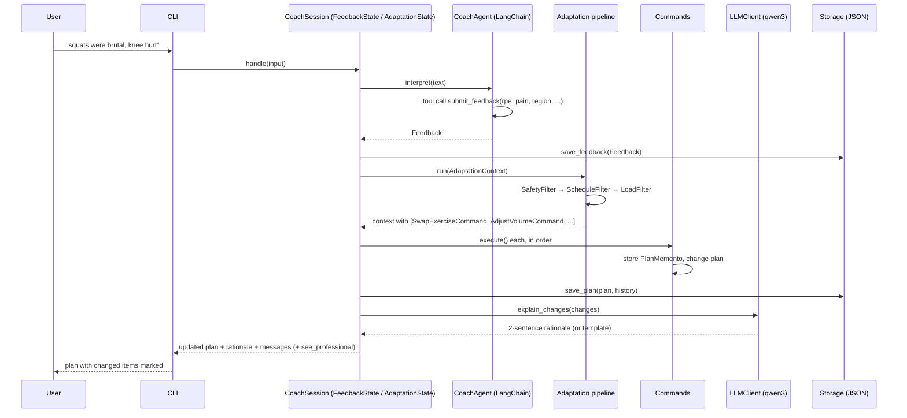
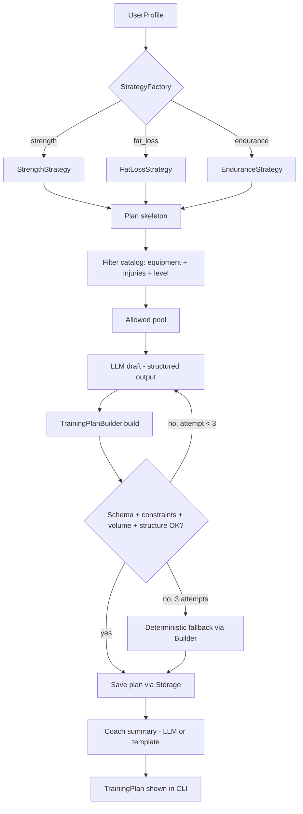

# Adaptive Fitness Agent — Functional Flow

## 0. Governing design decision

Two different kinds of logic are kept strictly apart. Everything below follows from this rule:

| Concern | Who decides | Why |
|---|---|---|
| **Is this plan safe / does it fit the profile?** | Deterministic rules (Strategy + Builder) | Predictable, testable, auditable |
| **Does the plan change, and how much?** | Deterministic rules (adaptation pipeline) | Safety-relevant, must be reproducible in tests |
| **Understanding the user's words; phrasing and explaining the plan** | LLM (LangChain + Ollama `qwen3`) | Natural language is the only reason to call a model |

**Consequence:** the LLM *understands*, *drafts* and *explains*; it never has the last word. Every LLM
output passes a validation gate before it can reach the user or be saved. The app therefore works with
the model switched off.

**Retry rule (same for every LLM step):**

| LLM step | Attempts | After the last failed attempt |
|---|---|---|
| Structured output: `extract_profile()`, `generate_plan()` | at most **3** (1 + 2 retries) | deterministic fallback |
| Free text: `summarize_plan()`, `explain_changes()` | **1** | template text |
| Agent (feedback in free text) | **1** (its own tool loop counts as one attempt) | the four fixed questions |

A structured attempt fails if the output does not match the Pydantic schema (detected by the adapter) or
does not pass the domain checks (detected by the Builder or the profile validation). Both kinds of failure
count against the **same** budget. The retry loop lives in the **application layer**; the adapter makes
exactly one model call per attempt and raises an `LLMError` on invalid output or when the model is
unavailable. Each retry re-prompts with the specific error.

---

## 1. Actors and components

| Actor / component | Layer | Responsibility |
|---|---|---|
| **User (trainee)** | – | Enters profile, views plan, gives feedback, can undo the last change |
| **CLI** | interface | Shows the current state and reads input; no business logic |
| **Composition root** (`interface/main.py`) | interface | Creates the concrete objects and passes them in |
| **CoachSession + states** | application | Controls the phases: onboarding, plan review, feedback, adaptation (State pattern) |
| **Application services** | application | Use cases called by the CLI (§10), including the LLM retry loop |
| **CoachAgent** (LangChain agent) | infrastructure (interface in application) | Turns free-text feedback into a structured `Feedback` via tools |
| **LLMClient / OllamaAdapter** | infrastructure (interface in application) | Wraps the model (Adapter): `extract_profile()`, `generate_plan()`, `summarize_plan()`, `explain_changes()` |
| **Storage / JsonStorage** | infrastructure (interface in application) | Saves and loads profile, plan, feedback and change history as JSON |
| **CatalogLoader / JsonCatalogLoader** | infrastructure (interface in application) | Loads `resources/exercise_catalog.json` into a list of `Exercise` objects |
| **StrategyFactory → PlanningStrategy** | domain | Encodes *what a good plan looks like* for one goal (split, volume, rep ranges, weekly progression) |
| **TrainingPlanBuilder** | domain | Turns the LLM draft into a `TrainingPlan` Composite and runs the validation gate |
| **Exercise catalog** (`Exercise` objects) | domain | Exercise pool with equipment and contraindication tags |
| **Adaptation pipeline** | domain | `SafetyFilter → ScheduleFilter → LoadFilter`, emits Commands |
| **Commands + Mementos** | domain | Apply plan changes; snapshot before each change; undo |

---

## 2. Core data model (logical — field names, not final schema)

```text
UserProfile
  age, fitness_level (beginner|intermediate|advanced),
  goal (strength|fat_loss|endurance), days_per_week (1..7),
  equipment[] (bodyweight|dumbbells|barbell|kettlebell|bands|pullup_bar|machines),
  injuries[]  ({region: knee|shoulder|lower_back|wrist|ankle|neck|hip, note?}),
  injury_notes[] (free text that matches no known region),
  minor (bool, derived from age)

Exercise (catalog entry)
  id, name, movement_pattern (squat|hinge|push|pull|carry|core|cardio),
  required_equipment[], contraindicated_regions[],
  is_compound (bool), default_rep_range, load_type (kg|bw|rpe|time), level

TrainingPlan (Composite root)
  weeks[], coach_summary (text), llm_generated (bool),
  held_patterns {movement_pattern: last_held_week},
  last_increase_week {exercise_id: week}
  └─ Week (Composite)          number (1..4), sessions[]
     └─ Session (Composite)    day_of_week, focus (e.g. "push"),
                               status (planned|done|missed|dropped), exercises[]
        └─ PlannedExercise (Leaf)  exercise_id, sets, reps, load (kg | bodyweight | RPE | seconds),
                                   rest_s, notes

  Every level implements: total_volume(), duration(), scale_intensity(factor)

Feedback
  session_ref, rpe (1..10), pain (bool), pain_region?,
  all_sets_done (bool), completed_sets?, missed_sessions (0..n), note?

AdaptationContext (the data passed along the pipe)
  feedback, previous_feedback?, plan, profile, strategy (limits),
  commands[] (emitted so far), no_increase (bool), see_professional (bool), messages[]

PlanMemento
  snapshot of the TrainingPlan before a change, plus the reason (which rule fired)

HistoryEntry
  one feedback cycle: feedback_ref, commands[] (in execution order)
```

**Change rule:** a `TrainingPlan` is only changed by a **Command**. Each Command stores a `PlanMemento`
in `execute()` before changing anything and restores it in `undo()`. Because `held_patterns` and
`last_increase_week` are part of the plan, they are covered by the Memento too. The list of
`HistoryEntry` objects is the plan's version history.

---

## 3. Flow F1 — Onboarding → `UserProfile`

**Trigger:** first start (no saved profile), or the user chooses "Redo onboarding".
**State:** `OnboardingState`.

1. The CLI asks for six inputs: **age**, **fitness level**, **goal**, **available days/week**,
   **available equipment**, **injuries/limitations**.
2. Answers can be typed freely (e.g. "two dumbbells and a pull-up bar"). `LLMClient.extract_profile()`
   turns the text into the profile fields. This is the only LLM step here, and it only *reads* language.
3. Validation runs deterministically on the result (Pydantic model + rules below), no matter whether the
   values came from the LLM or were typed directly:

   | Field | Rule | On violation |
   |---|---|---|
   | age | integer 14–90 | re-ask |
   | age < 18 | set `minor = true` | minor caps (below) + note in plan |
   | fitness_level | one of the three enum values | re-ask |
   | goal | one of `strength`, `fat_loss`, `endurance` | re-ask |
   | days_per_week | integer 1–7 | re-ask |
   | equipment | subset of the known list; `bodyweight` always implicit | drop unknown values |
   | injuries | region ∈ known list, optional free-text note | unknown region → stored in `injury_notes` (see below) |

   **Minor caps** (`minor = true`): at most 4 sessions per week; no exercise with level `advanced`;
   weekly sets at most the strategy's *beginner* maximum; kg increases always use the small step
   (+2.5 %, §6.3).

   **Unknown injury region:** the text is kept in `injury_notes`. It cannot be filtered automatically, so
   the plan summary repeats it and adds the "see a professional" hint (§13.5).

   Extraction follows the retry rule (§0): after 3 failed attempts the CLI asks each field as a
   fixed-choice question.
4. The profile is saved through `Storage`.
5. `OnboardingState` returns the next state → plan generation (F2).

**Output:** a validated `UserProfile`.
**Edge cases:** 7 days/week → still at least one rest day is scheduled (max 6 sessions, §6.4).
No equipment at all → allowed; the strategy restricts the pool to bodyweight exercises.
Injury that blocks a whole movement pattern → the strategy substitutes within the pattern or, if nothing
is safe, omits the pattern and says so in the summary.

---

## 4. Flow F2 — Plan generation → `TrainingPlan`

**Input:** validated `UserProfile`. **State:** `PlanReviewState` shows the result.

1. **Strategy selection (Simple Factory).** `StrategyFactory.create(profile)` returns one of
   `StrengthStrategy`, `FatLossStrategy`, `EnduranceStrategy`, chosen by `profile.goal`.
   New goals are added by registering a new strategy class; the callers do not change.

2. **Deterministic skeleton.** The strategy produces the *shape* of the plan:
   - split template mapped onto `days_per_week` (e.g. 3 days → full body ×3; 4 days → upper/lower ×2),
   - target sets per **movement pattern** per week for this goal and level,
   - rep ranges, rest times, session duration budget,
   - the limits used by the Builder and the adaptation guardrails (weekly sets min/max),
   - the weekly progression rule used to derive weeks 2–4 (step 4).

3. **Candidate pool filtering (hard safety filter).** From the exercise catalog, remove every exercise that
   - requires equipment the user does not have, **or**
   - is contraindicated for a reported injury region, **or**
   - is above the user's level (e.g. advanced skill work for a beginner; for minors also every `advanced` one).
   What remains is the **allowed pool**. The LLM only ever sees this pool.

4. **LLM draft.** `LLMClient.generate_plan()` (OllamaAdapter → `qwen3`, `with_structured_output`,
   temperature 0) gets the profile, the skeleton and the allowed pool. The model returns a Pydantic
   `PlanDraft` for **week 1** with concrete exercises, sets, reps and load; the Strategy derives weeks 2–4
   from it with its progression rule (see §13.4).

5. **Validation gate (Builder, always runs).** `TrainingPlanBuilder` turns the draft into the
   `TrainingPlan` Composite; `build()` checks:
   - *Schema complete* — required fields present, types correct, exercise ids exist in the catalog.
   - *Constraint compliance* — every exercise ∈ allowed pool (equipment + injury safe). **Hard fail.**
   - *Volume sanity* — sets × reps within the strategy's range; sessions ≤ `days_per_week`;
     ≥ 1 rest day; total weekly sets within the strategy's min/max (and the minor caps).
   - *Structure sanity* — no duplicate exercise inside a session; compounds first.
   On failure: re-prompt with the specific violation, following the retry rule (§0: at most 3 attempts
   in total, schema errors included); then → **step 6**.

6. **Deterministic fallback.** The strategy assembles the plan from the allowed pool with fixed selection
   rules (no LLM), through the same Builder. Result is flagged `llm_generated = false`.

7. **Coach summary (LLM, optional).** `LLMClient.summarize_plan()` explains in plain text *why* this plan
   fits the profile (1 attempt). If it fails, a templated summary is used. Presentation only — it never
   feeds back into decisions.

8. **Save** the plan through `Storage`. The change history starts empty.

**Output:** the `TrainingPlan` shown in the CLI (week × session × exercises), plus the coach summary.

---

## 5. Flow F3 — Feedback after a session

**Trigger:** the user finishes (or skips) a session and chooses "Give feedback".
**State:** `FeedbackState`.

1. The user can describe the session in free text (e.g. "squats were brutal and my knee hurt, skipped
   Thursday"). The **LangChain agent** reads it and calls the `submit_feedback` tool with structured
   arguments. Its other tools are `get_profile`, `get_current_plan` and `undo_last_change`; no tool
   changes the plan directly.
2. If the agent fails (no tool call, invalid arguments, model unavailable), `FeedbackState` falls back to
   four fixed questions that produce the same `Feedback`:
   - **How hard was it?** — RPE 1–10.
   - **Did anything hurt?** — yes/no; if yes, which region (same list as injuries).
   - **Did you complete all sets?** — yes/no; if no, how many sets were done.
   - **Did you miss any planned session?** — number of missed sessions.
3. Validation: `rpe ∈ 1..10`, `completed_sets ≤ planned_sets`, `missed_sessions ≥ 0`, region in the known
   list. If the agent reports pain without a known region, the fixed region question is asked.
4. The logged session gets `status = done`; the feedback is saved through `Storage`, linked to the session.
5. The state machine moves to `AdaptationState` (F4).

**Output:** a validated `Feedback`.

> **Note:** the decision *what to change* is made in F4 by rules, never by the LLM. The LLM may only
> describe the change afterwards.

---

## 6. Flow F4 — Adaptation (Pipes & Filters + Commands)

### 6.1 Pipeline

`AdaptationContext` → `SafetyFilter` → `ScheduleFilter` → `LoadFilter` → list of Commands → execute.

All filters share one interface: `process(context: AdaptationContext) -> AdaptationContext`. The context
(§2) is the data format passed along the pipe. Each filter reads it, may add Commands, flags and messages,
and passes it on; it never executes a Command itself. Each filter is small and independently testable; a
new rule is a new filter.

**Why this order:** `SafetyFilter` and `ScheduleFilter` can both set `no_increase`, so `LoadFilter`, the
only filter that increases load, runs **last** and respects the flag. Pain is checked first because it
has the highest precedence.

**Error handling:** if a filter raises an exception or gets invalid input, the pipeline stops, **no**
Command is executed, the plan stays unchanged and the user is told that the plan could not be adapted.
The feedback stays saved, so the user can retry.

| Filter | Handles | Emits / sets |
|---|---|---|
| `SafetyFilter` | pain (precedence 1) | `SwapExerciseCommand`, `AdjustVolumeCommand` (decrease); sets `no_increase`, `see_professional` |
| `ScheduleFilter` | missed sessions, rest-day guardrail | `RescheduleCommand`; sets `no_increase` if a session is dropped |
| `LoadFilter` | difficulty / completion (precedence 2–6), load guardrails | `AdjustVolumeCommand` (increase or decrease) |

`AdjustVolumeCommand` changes sets, reps and/or load of one exercise in all its remaining occurrences.

### 6.2 Classification (inside `LoadFilter`)

Rows are checked from top to bottom; the first match wins. `previous_feedback` is the last saved
`Feedback` before the current one (any session).

| # | Signal | Classification |
|---|---|---|
| 1 | `pain = true` | **SAFETY** (already handled by `SafetyFilter`; `LoadFilter` does nothing) |
| 2 | `rpe ≥ 9`, or `rpe ≥ 8` and `previous_feedback.rpe ≥ 8` | **TOO_HARD_SEVERE** |
| 3 | `rpe = 8` | **TOO_HARD** |
| 4 | `all_sets_done = false` and `rpe = 7` | **TOO_HARD** |
| 5 | `all_sets_done = false` and `rpe ≤ 6` | **INCOMPLETE_LOW** (likely time/motivation, not load) |
| 6 | `rpe 5–7`, `all_sets_done = true` | **ON_TARGET** |
| 7 | `rpe ≤ 4`, `all_sets_done = true` | **TOO_EASY** |

Every combination of `rpe` (1–10) and `all_sets_done` falls into exactly one row.

### 6.3 Rules (deterministic)

**Where changes apply:** to the exercises of the logged session, in **all remaining** (`status = planned`)
occurrences of the same exercise in the plan. Sessions with status `done`, `missed` or `dropped` are never
changed. The Strategy's weekly progression in weeks 2–4 stays in place; the steps below are applied on
top of it.

**Load step** (one step up or down, by `load_type`):

| `load_type` | +1 step | −1 step |
|---|---|---|
| `kg` | compound `squat`/`hinge` exercises: **+5 %**; all others and every exercise for minors: **+2.5 %**; rounded to the nearest 0.5 kg | **−10 %**, rounded to the nearest 0.5 kg |
| `bw` | **+1 rep per set** up to the top of the rep range; at the top: **+1 set** | **−2 reps per set** (minimum 1 rep) |
| `time` | **+10 %** duration, rounded to 5 s | **−10 %**, rounded to 5 s |
| `rpe` | target RPE **+1** (maximum 9) | target RPE **−1** (minimum 5) |

If a kg increase rounds to 0 kg or would break the +10 % guardrail (§6.4), the step becomes **+1 rep per
set** instead (within the rep range; at the top of the range: no change).

| Precedence | Condition | Action |
|---|---|---|
| **1** | `pain = true` (`SafetyFilter`) | **Offending exercises** = exercises of the logged session whose `contraindicated_regions` contains `pain_region`. Each one is swapped (`SwapExerciseCommand`) for the first catalog exercise with the same movement pattern that is in the allowed pool and not contraindicated for `pain_region`; the replacement starts at **70 % of the old load** (kg) or the bottom of its rep range (other load types). No safe alternative → the exercise is removed from the remaining sessions and the summary says so. **No exercise matches** the region → every exercise of the session gets −1 load step. The patterns of the offending exercises are **held** until the end of the next week (`held_patterns`). Sets `no_increase = true` and `see_professional = true`. |
| **2** | TOO_HARD_SEVERE | **Deload:** every exercise of the session −1 set (minimum 2 sets); exercises already at 2 sets get −1 load step instead. Rest intervals stay the same. |
| **3** | TOO_HARD | The exercise with the **highest volume** (sets × reps; tie → the first in the session) gets −1 set; if it already has 2 sets, −1 load step instead. The rest of the plan stays the same. |
| **4** | ON_TARGET | **No change.** The built-in weekly progression continues. |
| **5** | TOO_EASY | Every exercise of the session +1 load step, unless an increase is forbidden (§6.4). |
| **6** | INCOMPLETE_LOW | **No change.** The CLI shows the hint: "Plan unchanged. If time is the problem, choose 'Redo onboarding' with fewer days per week." |
| **–** | `missed_sessions = n > 0` (`ScheduleFilter`) | The missed sessions are the latest *n* planned sessions of the current week before the logged session. Each gets status `missed` and is moved (`RescheduleCommand`) to the next free day of the same week after the logged session, if the week still keeps at least one rest day. If no such day exists, the session gets status `dropped` and `no_increase = true` for this cycle. |

Only **one** load rule (1–6) is applied per cycle, and rule 1 always wins.

### 6.4 Global guardrails (checked by the filters against the Strategy's limits)

An increase (+1 step or +1 set) is forbidden for an exercise if **any** of these holds:
- `no_increase = true` in the context (pain or a dropped session in this cycle);
- its movement pattern is in `held_patterns` for the current week;
- it was already increased this week (`last_increase_week[exercise_id] = current week`), so each exercise
  gets **at most one increase per week**, which keeps load at **≤ +10 %** and volume at **≤ +1 set** per week;
- the current feedback has `all_sets_done = false`;
- the increase would push total weekly sets above the strategy's maximum (or the minor cap).

Always:
- An exercise is never both increased and decreased in the same cycle.
- Sessions per week ≤ `days_per_week`; **at least one rest day** per week.
- Decreases never go below 2 sets or 1 rep, and never below the strategy's weekly set minimum
  (then the decrease is skipped and the CLI says so).

### 6.5 Output

1. The Commands are executed in the order they were emitted; each stores a `PlanMemento` (snapshot + rule
   that fired) before it changes the plan. Together they form **one** `HistoryEntry`.
2. The updated plan and the history are saved through `Storage`.
3. `LLMClient.explain_changes()` writes a two-sentence explanation of *what changed and why* (1 attempt).
   On failure → a templated sentence derived from the rule that fired.
4. The CLI shows the updated plan (changed items marked), the explanation, the messages (e.g. the
   INCOMPLETE_LOW hint) and — if `see_professional = true` — the text from §13.5.
5. **Undo:** the user can choose "Undo last change" (or ask the agent, which calls `undo_last_change`).
   This undoes the **last `HistoryEntry`**: its Commands call `undo()` in reverse order, so the plan is
   exactly as it was before that feedback cycle. Calling undo again goes one more cycle back.

---

## 7. End-to-end overview

```text
  ┌──────────┐
  │  START   │
  └────┬─────┘
       ▼
  F1 ONBOARDING (OnboardingState) ── age, level, goal, days, equipment, injuries
       │  extract_profile (LLM, ≤ 3 attempts) → validation, else fixed questions
       ▼
   UserProfile ──────────────────────────────────┐
       ▼                                         │
  F2 PLAN GENERATION (PlanReviewState)           │
   StrategyFactory → Strategy → skeleton         │  (rules + catalog)
   catalog filter → allowed pool                 │
   LLM draft (qwen3) ──► Builder gate ──3 fails──┤
       │ pass                                    ▼
       │                                  deterministic fallback
       ▼                                         │
   TrainingPlan (Composite) ◄────────────────────┘
       │  + coach summary (LLM or template)
       ▼
   ┌─► user trains ─► F3 FEEDBACK (FeedbackState)
   │                   agent (free text) or 4 fixed questions
   │                        │  Feedback
   │                        ▼
   │                  F4 ADAPTATION (AdaptationState)
   │                   SafetyFilter → ScheduleFilter → LoadFilter
   │                        │  Commands (each stores a Memento) = 1 HistoryEntry
   │                        ▼
   └─────────────── updated TrainingPlan + coach explanation
                            │
                            ▼
                    "undo last change" undoes the last HistoryEntry
```

---

## 8. Sequence — feedback to adapted plan (Mermaid)



---

## 9. Flowchart — plan generation with the validation gate (Mermaid)



---

## 10. Application services used by the CLI

| Service call | Flow | Purpose |
|---|---|---|
| `onboard(answers)` | F1 | Build and save the `UserProfile` |
| `generate_plan()` | F2 | Create the `TrainingPlan` |
| `show_plan()` | – | Current plan and coach summary |
| `submit_feedback(text or answers)` | F3 → F4 | Feedback, then adaptation |
| `undo_last_change()` | F4 | Undo the last `HistoryEntry` |
| `show_history()` | – | List of executed changes and the rules that fired |

---

## 11. Pattern mapping (for PATTERNS.md)

| Pattern | Where it appears in this flow |
|---|---|
| **Layers** | §1 — interface / application / domain / infrastructure; dependencies point inward; `interface/main.py` composes the layers |
| **State** | §3–§6 — `OnboardingState`, `PlanReviewState`, `FeedbackState`, `AdaptationState`; each returns the next state |
| **Adapter** | §3.2, §4.4 — `OllamaAdapter` implements `LLMClient`; the domain never imports LangChain |
| **Strategy + Simple Factory** | §4.1–4.2 — one planning strategy per goal; `StrategyFactory` picks it |
| **Composite** | §2 — `TrainingPlan → Week → Session → PlannedExercise`; same operations at every level |
| **Builder** | §4.5 — `TrainingPlanBuilder` assembles the Composite and runs the validation gate |
| **Pipes & Filters** | §6.1 — `SafetyFilter → ScheduleFilter → LoadFilter`, common `process()` interface, `AdaptationContext` as data format |
| **Command + Memento** | §6.5 — every change is a Command storing a Memento; undo restores the last feedback cycle |

---

## 12. Test hooks for our own metrics

**LLM structured-output validity rate** (F2, §4.5): for N test profiles, the share of LLM drafts that pass
the Builder gate (schema + constraint compliance) **on the first attempt**. We also report the share that
needed the deterministic fallback. Compared across `qwen3:4b` and `qwen3`. After the gate, constraint
compliance of the *final* plan must always be 100 %.

**Adaptation safety rate** (F4, §6.3): the share of scenario tests where reported pain never leads to a
load increase. Target: 100 %.

Scenario tests (run without a real LLM, using `FakeLLMClient`):

| Scenario | Expected |
|---|---|
| RPE 3, all sets done, no pain | every exercise of the session +1 load step (e.g. 60 kg squat → 63 kg) |
| Same exercise TOO_EASY twice in one week | second increase is skipped (one increase per week) |
| RPE 6, all sets done, no pain | plan unchanged |
| RPE 8, no pain | highest-volume exercise −1 set (or −1 load step at 2 sets) |
| RPE 8 after a previous RPE 8 | deload: every exercise −1 set (minimum 2) |
| RPE 10, no pain | deload: every exercise −1 set (minimum 2) |
| Knee pain reported | offending exercise swapped (70 % load), pattern held, no load increase anywhere, `see_professional = true` |
| Pain in a region no exercise is tagged for | every exercise −1 load step, no swap, `see_professional = true` |
| RPE 4, sets incomplete | plan unchanged, hint shown |
| 1 missed session, free day available | session moved, rest day kept |
| 1 missed session, no free day, RPE 3 | session dropped, **no** load increase |
| Pain + RPE 3 | swap only, no increase on any exercise |
| Any rule fires, then undo | plan identical to the state before that feedback cycle |
| Any rule firing | ≤ +10 % weekly load and ≤ +1 set per exercise |
| Filter raises an exception | no Command executed, plan unchanged |

---

## 13. Assumptions and decisions

1. ~~LLM drafts the plan; rules decide adaptations.~~ **Decided:** yes. The LLM never decides load changes.
2. ~~RPE 1–10 as the only difficulty input?~~ **Decided:** yes, plus pain, completion and missed sessions.
   Recovery/motivation are left out to keep the flow short (YAGNI).
3. ~~Injury input?~~ **Decided:** regions from a fixed list + free text, which makes constraint compliance
   checkable automatically. Text that matches no region goes to `injury_notes` (§3).
4. ~~Plan length?~~ **Decided:** a **4-week plan**. The LLM drafts only **week 1**; the Strategy copies it
   to weeks 2–4 and applies its progression rule (e.g. +1 rep per set per week). This keeps the LLM output
   small (better validity with a local model), gives the Composite a real `Week` level, and keeps the
   progression deterministic. Because this progression is built in, ON_TARGET feedback changes nothing.
   Adaptation changes the logged session's exercises in the **remaining** sessions of the plan; completed
   sessions are never changed. After week 4 the user is offered a new plan (F2 again with the same profile).
5. ~~Pain wording?~~ **Decided:** pain is a recommendation and a flag; the app does not diagnose anything.
   The CLI shows: *"You reported pain. We changed the exercise and lowered the load. If the pain is sharp,
   in a joint, or still there at your next session, stop training that area and see a doctor or
   physiotherapist. This app does not diagnose injuries."*
6. ~~Exercise catalog owner?~~ **Decided:** **Rahul**, because the catalog feeds the safety filter and the
   Strategies, which are his domain half. It is our own hand-curated JSON file (not model-generated), so
   the safety filter is testable without a model:
   - File: `resources/exercise_catalog.json` (not under `data/`, which `.gitignore` excludes because it
     holds the user's saved profile and plans).
   - Size: about 40–60 exercises, covering every movement pattern, every equipment option and all three
     levels, so every profile has a non-empty allowed pool. A unit test checks this.
   - Every entry has all fields from §2 (`required_equipment`, `contraindicated_regions`, `level`, …).
   - `JsonCatalogLoader` (infrastructure) loads the file; the domain only receives the list of `Exercise`
     objects.
   - If AI helps to draft entries, it is logged in `AI_USAGE.md` and every entry is checked by hand.
7. **Numbers are project assumptions**, not medical advice: the load steps, the 70 % restart load and
   the minor caps are common training rules of thumb chosen to make the behaviour testable.
